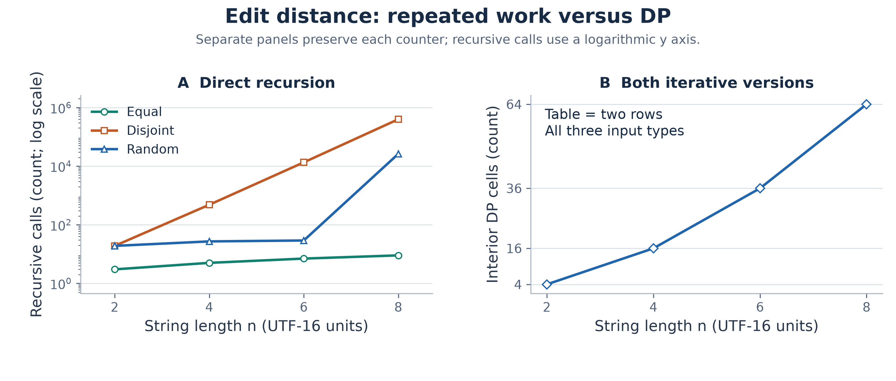
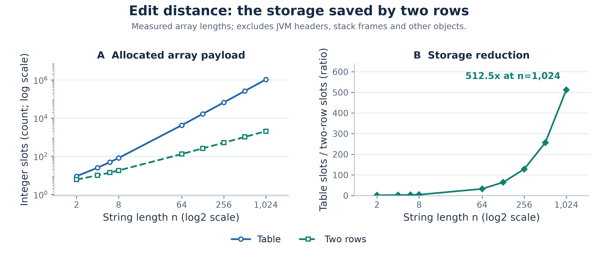
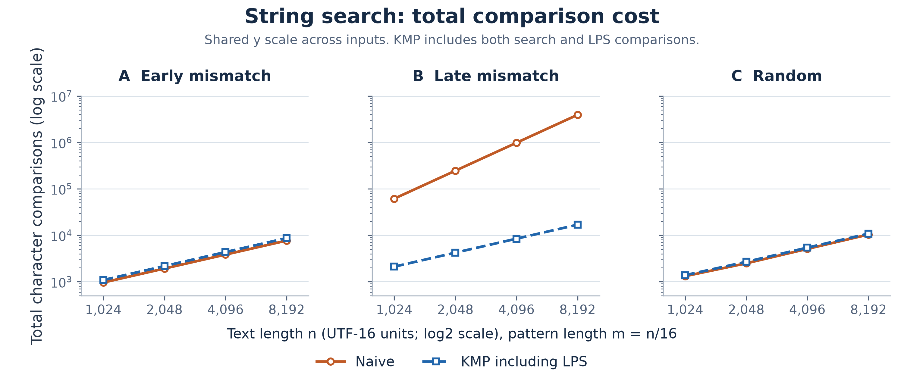
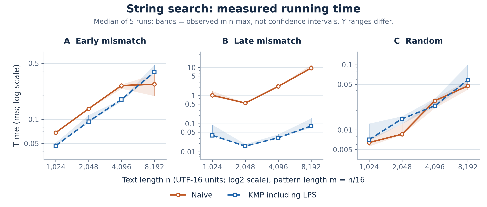
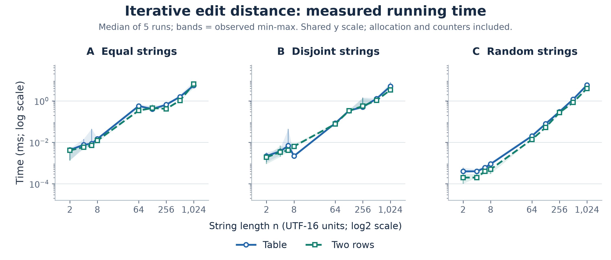

# Experiment Design Card

| Field | Plan recorded before runs |

|---|---|

| Questions | Edit: does DP remove repeated work, and how much storage do two rows save? Search: how much work does KMP avoid on late mismatches? |

| Sizes | Edit, all versions: 2, 4, 6, 8; iterative versions also 64, 128, 256, 512, 1024. Search: 1024, 2048, 4096, 8192; pattern m=n/16. Each algorithm spans at least four sizes and a fourfold range. |

| Inputs | Edit: equal A^n / A^n (best recursive path), disjoint A^n / B^n (full branching), seeded random over A-D. Search: B^n / A^m (early mismatch), A^n / A^(m-1)B (late mismatch, naive worst case), seeded random over A-D. |

| Metrics | Count recursive calls, interior DP cells, allocated DP integer slots, and character comparisons inside algorithms. Search work includes LPS comparisons. Record five individual times and plot the median. |

| Predictions | Disjoint recursion grows exponentially, equal recursion linearly. Both DP versions do n squared cell updates; two rows use linear storage. Naive late-mismatch search grows quadratically because m grows with n; KMP stays linear. |

| Planned plots | Common-size edit work (log y), DP storage (log y), total search comparisons (log y), median edit and search timings (log y). Each chart answers one growth or resource question. |

## Method and scope

The design was committed before the first experiment (docs/EXPERIMENT_DESIGN.md). After collecting data, the figures were refined: separate counter panels, clearer size axes, shared comparison scales, a storage ratio and observed timing ranges. Inputs, predictions and raw measurements were unchanged. Seed 20261108 fixes inputs, answers and counters, but cannot fix wall-clock time. Each case has five untimed warmups, then five measured invocations with counters enabled; search timing includes LPS construction. There are 450 measured rows. JVM warmup is modest rather than a full JMH study. Java 25.0.2 runs Java-17-targeted classes on Windows amd64. The recursive cap of 8 is a chosen budget, not a measured hardware maximum.

## Edit distance: prediction versus result

Disjoint recursion reaches 398,593 calls at n=8, whereas each DP version evaluates 64 cells. At n=1024, both iterative versions evaluate 1,048,576 cells. The full table allocates 1,050,625 integer slots; two rows allocate 2,050, a 512.5-fold reduction. Their disjoint median times are 5.0468 and 3.3663 ms, respectively. This supports the predicted work and storage trends. Equal-string recursion follows one diagonal, while both DP implementations still fill every interior cell. Calls and DP cells are different work units, so their counts illustrate growth, not an exact time conversion. Slots exclude object headers and recursive stack frames.

Disjoint recursion branches rapidly; the separate DP panel combines six identical measured curves.

Two rows use 512.5 times fewer integer slots at n=1024; the ratio comes from measured slots.

## String search: prediction versus result

At n=8192 and m=512, late mismatches require 3,932,672 naive comparisons and 16,894 KMP comparisons including preprocessing: a 232.8-fold work ratio. Their medians are 9.5465 and 0.0827 ms. This matches the predicted quadratic versus linear trend for this input design. KMP is not universally cheaper: at the largest early-mismatch case, naive uses 7,681 comparisons versus 8,703 for KMP including LPS. Random cases usually reject naive candidates early. Comparison panels share one vertical scale; timing panels use separate ranges. Timing bands show the minimum and maximum of the five observed runs, not confidence intervals.

Late mismatches separate naive quadratic growth from KMP linear work; preprocessing is included.

Late mismatches cost naive the most time; early-mismatch and random timings need their own scale.

## Short answers

### Which search input was slowest?

Late mismatch at n=8192 was the slowest naive search in this experiment. Every candidate matches 511 characters before failing on the final B, so naive repeatedly scans the same text. KMP retains prefix information and avoids most repeated comparisons.

### How large could recursive edit distance handle?

The largest tested length was 8 for both strings; disjoint inputs already caused 398,593 recursive calls. The experiment deliberately stopped there because the branching recurrence grows exponentially. No failure threshold or maximum feasible length was measured, so 8 is a tested cap rather than a hardware limit.

### What do two rows gain and lose?

Two rows retain the same distance and O(nm) running time with O(min(n,m)) auxiliary array storage. At n=1024 they save a factor of 512.5 in allocated integer slots. Discarding earlier rows removes the straightforward full-table traceback for reconstructing edits, although more advanced reconstruction methods exist.

### Which search should the city platform use?

KMP is the safer default for long logs because it gives O(n+m) worst-case search including preprocessing. The late-mismatch data demonstrate why this matters for repetitive inputs. Naive search can be simpler and cheaper on short or immediately rejected patterns; exact matching also does not itself correct spelling.

## Time measurements

Measured times were positive but small at short lengths, and some curves were not monotone. JIT compilation, allocation, garbage collection, CPU scheduling and instrumentation can affect a five-run median; the fixed case order can also bias timing comparisons. For example, the largest early-mismatch naive/KMP medians were 0.2732/0.3884 ms. Operation counts provide more stable evidence of growth than a claim based on one laptop timing. These numbers are observations, not universal speed guarantees.

Logarithmic size axes reveal small inputs; bands show the full observed range of five runs.

## Correctness and evidence

JUnit 5: 8 test methods passed, including all supplied references, empty inputs, overlaps, exact counter checks and 100 seeded comparisons per family. Search random tests also use String.indexOf as an independent oracle. A second experiment run matched all 450 rows after excluding time_ms. See results/VALIDATION.md. Definitions and limitations are explicit so the claims can be checked against results/results.csv.